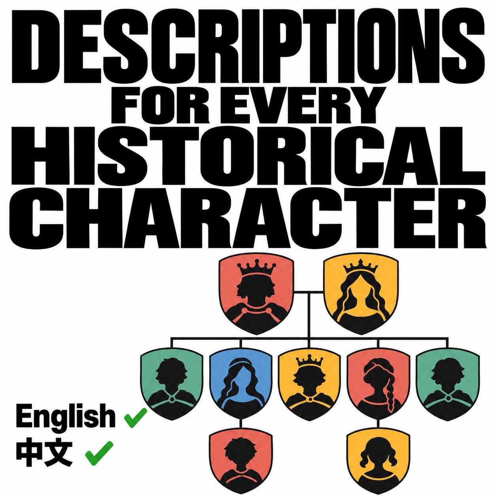

# Descriptions for Every Historical Character / 所有历史人物的描述

**[English](#english) · [简体中文](#简体中文)**

## English

A Europa Universalis V mod with English and Simplified Chinese biographies for 7,789 real historical characters in the game, from rulers, heirs and regents to their ancestors and relatives.

### Getting started

Subscribe on the [Steam Workshop](https://steamcommunity.com/sharedfiles/filedetails/?id=3833397845) and enable the mod in Mods and DLC. Hover over a character's portrait; the biography is at the bottom of the tooltip, and long ones scroll inside it.

Prefer not to use the Workshop? Download the ZIP from [Releases](https://github.com/wangyufeng0615/eu5-character-descriptions/releases/latest):

1. Download `character_descriptions-<version>.zip`.
2. Extract it into `Documents\Paradox Interactive\Europa Universalis V\mod\`, so that you have `mod\character_descriptions\` (keep the hidden `.metadata` folder).
3. Start EU5 and enable **Descriptions for Every Historical Character** in Mods and DLC.

Use either the Workshop copy or the ZIP copy, not both. To update, delete the old folder and extract the new ZIP. See the [changelog](CHANGELOG.md) for what changed.

### Language

English and Simplified Chinese; the game language picks which one you see.

### Compatibility

It only adds biography text to the character tooltip, so it can be added to an existing save and does not affect performance. Ironman and achievement compatible. Some characters the game creates through events can't be matched yet, so they show no biography.

### About the text

The biographies were written with AI assistance from published sources, mostly Wikipedia in English or the local language, matched to the game's characters and reviewed entry by entry. Per-character sources ship with the mod in `sources/sources.jsonl`. Corrections are welcome in the Workshop comments or as GitHub issues; include the character's name.

### Source and build

The biographies are written and checked in a separate research repository and exported into `data/`; don't edit `data/` by hand. Building needs Python 3.10 or newer and nothing else:

    python -B tools/build.py --check
    python -B -m unittest discover -s tests -v
    python -B tools/build.py --output dist/my-build

Use a new output directory for each build. The result is the mod folder, a ZIP and a checksum receipt. Pushing a tag `vX.Y.Z` builds that commit on GitHub Actions and attaches the ZIP to a release.

### Credits and reuse

Biographies and translations are **CC BY-SA 4.0**; tools are **MIT**. See [LICENSE](LICENSE) and [CREDITS.md](CREDITS.md). The cover is an AI-assisted graphic and is not covered by either licence. `mod_template/in_game/gui/zz_cb_character_tooltips.gui` is the vanilla character tooltip with a biography block added; it belongs to Paradox. This is an unofficial community project, with no affiliation to Paradox, Valve or Wikimedia.

## 简体中文

《欧陆风云5》模组，为游戏里 7,789 位真实历史人物提供英文和简体中文生平，从君主、继承人、摄政到他们的先祖和亲属。

### 怎么使用

在 [Steam 创意工坊](https://steamcommunity.com/sharedfiles/filedetails/?id=3833397845)订阅，在“模组和 DLC”里启用。鼠标停在人物头像上，生平在浮窗最下方，过长的会在浮窗内滚动。

不想用创意工坊，也可以从 [Releases](https://github.com/wangyufeng0615/eu5-character-descriptions/releases/latest) 下载 ZIP：

1. 下载 `character_descriptions-<版本号>.zip`。
2. 解压到 `文档\Paradox Interactive\Europa Universalis V\mod\`，解压后应有 `mod\character_descriptions\` 文件夹（保留其中隐藏的 `.metadata` 文件夹）。
3. 启动游戏，在“模组和 DLC”里启用 **所有历史人物的描述**。

创意工坊版和 ZIP 版二选一，不要同时启用。更新时删掉旧文件夹，再解压新的 ZIP。每次的改动见[更新记录](CHANGELOG.md)。

### 语言

支持英文和简体中文，按游戏语言显示。

### 兼容性

只在人物浮窗里增加生平文本，存档可以中途加入，不影响游戏性能。兼容铁人和成就。部分由事件生成的人物暂时对应不上，不显示生平。

### 内容是怎么写的

生平由 AI 辅助、依据公开资料（以英文或当地语言的维基百科为主）写成，与游戏里的人物逐一对应，并逐条审读。每个人物的资料来源随模组附在 `sources/sources.jsonl`。发现错误欢迎在工坊留言或提 GitHub issue，请带上人物名字。

### 源码与构建

正文在单独的研究仓库里撰写和核对，再导出到 `data/`，不要手改 `data/`。构建只需要 Python 3.10 以上，不需要游戏或其他依赖，命令见英文部分。每次构建用新的输出目录，产物是模组文件夹、ZIP 和哈希回执。推送 `vX.Y.Z` 标签后，GitHub Actions 从该提交构建，并把 ZIP 附到 Release。

### 来源与许可

生平和翻译采用 **CC BY-SA 4.0**，工具采用 **MIT**，见 [LICENSE](LICENSE) 和 [CREDITS.md](CREDITS.md)。封面是 AI 辅助生成的图形，不在这两个许可范围内。`mod_template/in_game/gui/zz_cb_character_tooltips.gui` 是加了生平区块的原版人物浮窗定义，归 Paradox 所有。本项目为非官方社区模组，与 Paradox、Valve、Wikimedia 没有关联。
